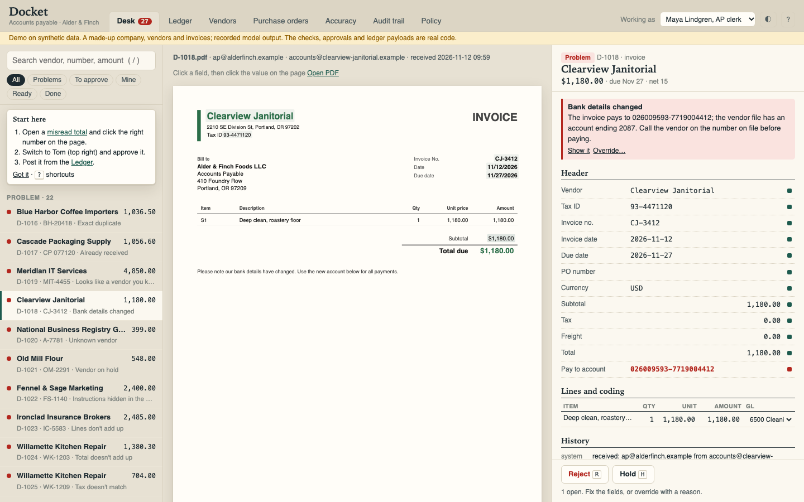
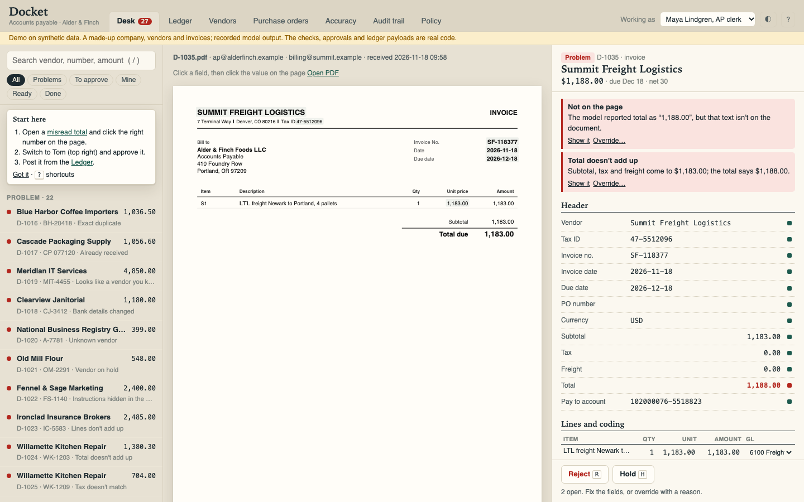
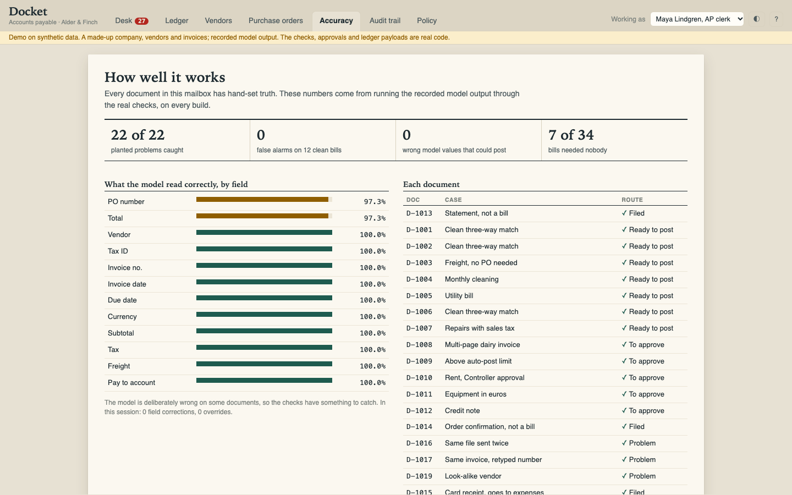

# Docket: accounts payable intake

Docket turns the invoices landing in an AP mailbox into bills your accounting system can trust. A model reads each PDF and quotes where it found every value. Code then checks the document against the page, the vendor file, purchase orders and receipts, and your policy. Clean bills flow straight through; anything doubtful lands on a review desk with the source page beside the fields, and nothing reaches QuickBooks or Xero without passing the checks or a person's approval.

**Live demo: https://sibrahimpa1.github.io/doc-intake/**

The demo runs on a synthetic mailbox with recorded model output, so it needs no API key. Try this: open a [misread total](https://sibrahimpa1.github.io/doc-intake/#doc/D-1035), click the right number on the page, switch to Tom and approve it, then post it from the Ledger.



## What it catches

| Area | Checks |
|---|---|
| The model | A value that isn't on the page, doesn't match what's printed, or was read with low confidence |
| Payment fraud | Changed bank details, look-alike vendors, unknown vendors, instructions hidden in a PDF |
| Duplicates | The same file, the same invoice with a retyped number, the same amount within a week |
| Arithmetic and tax | Line totals, subtotal, grand total, sales tax against the vendor's rate |
| Three-way match | Missing, unknown, closed or wrong-vendor POs, price above tolerance, billed more than received |
| Dates and currency | Closed periods, future dates, due before issued, terms that differ, wrong currency |
| Not a bill | Statements, order confirmations and receipts are filed instead of paid |

## How a document moves

```
mailbox or upload
  → model extracts fields, lines and the printed evidence for each
  → checks.py runs every rule
      clean and under the limit ─────────────▶ approved ─▶ posted to the ledger
      clean, above the limit or a credit note ▶ needs approval (by amount)
      any problem ──▶ exception: fix it, override with a reason, hold, or reject
      not a bill ───▶ filed
```

Who can do what is enforced in code:

- Whoever changed a document can't approve it.
- Approvals follow each person's limit; foreign currency is converted first.
- A changed bank account needs the Controller and a call-back reference.
- Duplicates, unknown or blocked vendors and closed POs can't be overridden at all.
- Every action goes into a hash-chained audit log, so an edited history is detectable.

## The desk

- **Source and fields side by side.** Hover or focus a field to see it on the page. Click a field, then click the word on the invoice to fill it in.
- **Re-checks as you type.** The browser runs a port of the Python rules, and a test keeps the two identical on every document.
- **Keyboard first.** `J`/`K` to move, `A` approve, `R` reject, `H` hold, `P` post, `/` search, `?` for help.
- **Roles.** Switch between AP clerk, AP manager and Controller to see what each may do.
- **Also in the app:** ledger with QuickBooks and Xero payloads, retry on outage and CSV export; vendor file; POs and receipts; accuracy; audit trail; editable policy.

| Fixing a misread | Accuracy against hand-set truth |
|---|---|
|  |  |

## Run it

```bash
python -m docintake demo           # run the mailbox through the checks, print the scorecard, build site/
python -m docintake doc D-1018     # one document: what was read and what the checks said
pip install pytest fastapi httpx python-multipart pypdf && python -m pytest -q
```

On real PDFs (needs an Anthropic API key):

```bash
pip install -e ".[live]"
export ANTHROPIC_API_KEY=...
python -m docintake extract invoice.pdf
DOCINTAKE_LIVE=1 uvicorn docintake.api:app --port 8000   # upload, queue, review and post over HTTP
```

To post for real, set `QBO_ACCESS_TOKEN` and `QBO_REALM_ID` and use `LiveLedger`, which targets the QuickBooks sandbox by default. The `X-User` header stands in for your SSO, so put a real identity provider in front before going live.

| Path | Role |
|---|---|
| `docintake/checks.py` | Every rule and the routing decision |
| `docintake/workflow.py` | States, permissions, separation of duties, audit log |
| `docintake/extract.py` | PDF text layer with positions, Claude structured extraction |
| `docintake/ledger.py` | QuickBooks and Xero payloads, idempotent posting with retries |
| `docintake/evals.py` | Scores the pipeline against hand-set truth |
| `docintake/api.py` | FastAPI service |
| `docintake/web/` | The review desk |
| `data/make_corpus.py` | Generates the vendor file, POs and invoices as real PDFs |

## Design choices

- **The model quotes, code verifies.** Every value comes with the text it was read from. If that text isn't on the page or doesn't parse to the value, the field is flagged, so a hallucinated number can't post.
- **A PDF is untrusted input.** Text addressed to an AI is treated as data and sends the document to a person.
- **Money is integer cents** throughout, so totals never drift.
- **The vendor file is the source of truth for bank details.** An invoice can never change where money goes.
- **Posting is idempotent.** A retry after a timeout can't create a second bill, and a ledger outage leaves the bill ready to post.

## Data

Everything is synthetic: the company, vendors, purchase orders, invoices, people and bank details. Some recorded extractions are wrong on purpose so the checks have something to catch.

## License

MIT
